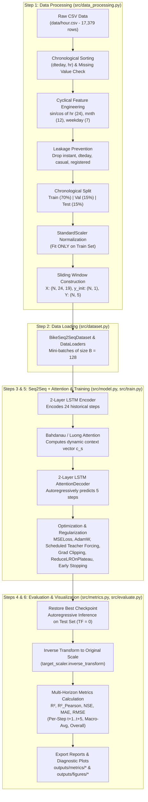
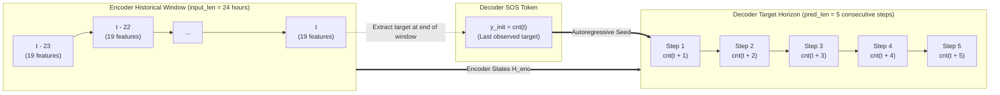
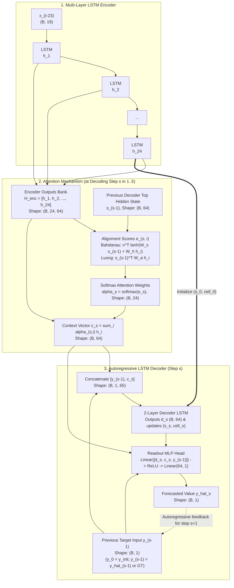

# Bike Sharing Multi-Step Forecasting — Encoder–Decoder (Sequence-to-Sequence) with Attention in PyTorch

An end-to-end **PyTorch** implementation of a **Sequence-to-Sequence (Encoder–Decoder)** neural network integrated with an **Attention mechanism** (Bahdanau Additive Attention and Luong Multiplicative Attention) to forecast `pred_column` (default: `cnt`, total bike rentals) for the **next five consecutive time steps** ($H = 5$).

The model is rigorously evaluated across both individual forecast horizons ($t+1 \dots t+5$) and pooled multi-step outputs using **$R^2$**, **NSE (Nash–Sutcliffe Efficiency)**, **MAE**, and **RMSE**.

---

## Table of Contents

1. [Problem Statement](#1-problem-statement)
2. [Repository Structure](#2-repository-structure)
3. [End-to-End Pipeline Architecture (Mermaid Diagrams)](#3-end-to-end-pipeline-architecture-mermaid-diagrams)
4. [Detailed Step-by-Step Pipeline Breakdown](#4-detailed-step-by-step-pipeline-breakdown)
5. [Deep Dive into the Model Architecture](#5-deep-dive-into-the-model-architecture)
6. [Evaluation Metrics for Sequence-to-Sequence Forecasting](#6-evaluation-metrics-for-sequence-to-sequence-forecasting)
7. [Experimental Results on the Test Set](#7-experimental-results-on-the-test-set)
8. [Installation & Usage](#8-installation--usage)

---

## 1. Problem Statement

Given historical multivariate observations from the **Capital Bikeshare Dataset** (`data/hour.csv`, 17,379 hourly records across 2011–2012), our objective is to:
1. Build an **Encoder–Decoder (Sequence-to-Sequence)** network that encodes a lookback window of $L = 24$ historical time steps and forecasts the values of `pred_column` for the **next $H = 5$ consecutive time steps**, starting from the current time step.
2. Incorporate an **Attention mechanism** between the Decoder and Encoder so the Decoder can dynamically attend to relevant historical hours (e.g., recent momentum vs. same-hour diurnal patterns from 24 hours ago) at each forecast step.
3. Research, formulate, and apply **$R^2$**, **NSE**, **MAE**, and **RMSE** to multi-horizon Sequence-to-Sequence predictions.

---

## 2. Repository Structure

```text
bike-sharing-forecast/
├── data/
│   ├── hour.csv                 # Hourly bike sharing dataset (17,379 records)
│   ├── day.csv                  # Daily bike sharing dataset (731 records)
│   └── Readme.txt               # Original dataset documentation
├── src/
│   ├── __init__.py              # Package initializer
│   ├── config.py                # Step 0: Dataclass configuration & hyperparameters
│   ├── data_processing.py       # Step 1: Cleaning, cyclical encoding, splitting, scaling, sliding windows
│   ├── dataset.py               # Step 2: PyTorch Dataset & DataLoader wrappers
│   ├── model.py                 # Step 3: Encoder, Bahdanau/Luong Attention, AttentionDecoder, Seq2Seq
│   ├── metrics.py               # Step 4: R², R² (Pearson), NSE, MAE, RMSE for multi-step Seq2Seq
│   ├── train.py                 # Step 5: Training loop, scheduled Teacher Forcing, Early Stopping
│   └── evaluate.py              # Step 6: Autoregressive inference, inverse scaling, tables & plots
├── outputs/
│   ├── checkpoints/             # Saved best model weights (best_seq2seq_attention.pt)
│   ├── figures/                 # Diagnostic plots (loss_curve.png, forecast_comparison.png, attention_heatmap.png)
│   └── metrics/                 # Evaluation reports (test_metrics.csv, test_metrics.json)
├── main.py                      # CLI entry point executing Step 1 through Step 6
├── requirements.txt             # Python dependencies
└── README.md                    # Comprehensive project documentation
```

---

## 3. End-to-End Pipeline Architecture (Mermaid Diagrams)

### 3.1 Overall Workflow Diagram



### 3.2 Sliding Window Construction Diagram



> [!NOTE]
> **Time Indexing Equivalence**: Whether one defines the current time step $t$ as the last observed step in the Encoder (forecasting $t+1, \dots, t+5$ from history $t-23 \dots t$) or as the first forecasted step in the Decoder (forecasting $t, \dots, t+4$ from history $t-24 \dots t-1$), the sliding window array slices `X = features[i : i + 24]` and `Y = target[i + 24 : i + 29]` are identical and strictly causal with zero future look-ahead.

---

## 4. Detailed Step-by-Step Pipeline Breakdown

### Step 1: Data Preprocessing & Feature Engineering (`src/data_processing.py`)
1. **Chronological Ordering**: Records are sorted by `(dteday, hr)` to guarantee a continuous hourly timeline.
2. **Cyclical Temporal Encoding**: Raw integer time columns (`hr` $\in [0, 23]$, `mnth` $\in [1, 12]$, `weekday` $\in [0, 6]$) have artificial discontinuities (e.g., hour 23 is adjacent to hour 0). We project them onto the unit circle:
   $$\text{hr\_sin} = \sin\left(\frac{2\pi \cdot \text{hr}}{24}\right), \qquad \text{hr\_cos} = \cos\left(\frac{2\pi \cdot \text{hr}}{24}\right)$$
   (and analogously for `mnth` with period 12 and `weekday` with period 7).
3. **Preventing Data Leakage**: In the Bike Sharing dataset, `cnt = casual + registered` at every timestamp. When forecasting `pred_column = "cnt"`, both `casual` and `registered` are dropped from the feature matrix alongside metadata columns (`instant`, `dteday`). The historical value of `cnt` itself is retained as the 19th feature (autoregressive signal).
4. **Chronological Splitting with Boundary Context**:
   - **Train Set**: First 70% of timestamps ($12,137$ sliding windows).
   - **Validation Set**: Next 15% of timestamps ($2,603$ sliding windows).
   - **Test Set**: Final 15% of timestamps ($2,603$ sliding windows).
   - *Boundary Context Padding*: Validation and Test splits prepend the immediately preceding `input_len = 24` rows as Encoder context so the very first target prediction of the split begins exactly at the split boundary without leaking any target labels.
5. **Leak-Free Standardization**: Two `StandardScaler` instances (`feature_scaler` for all 19 input features, `target_scaler` for `pred_column`) are fitted **exclusively on the Training split** and applied to Train, Validation, and Test splits.

### Step 2: PyTorch Dataset & DataLoaders (`src/dataset.py`)
- `BikeSeq2SeqDataset` wraps the 3-tuple `(X, y_init, Y)` as `torch.float32` tensors:
  - `x_enc`: shape `(24, 19)`
  - `y_init`: shape `(1,)`
  - `y_dec`: shape `(5,)`
- `build_dataloaders` constructs batched iterators (`batch_size = 128`, shuffling enabled only for `train_loader`).

### Step 3: Encoder–Decoder with Attention (`src/model.py`)
- Implements `Encoder`, `BahdanauAttention`, `LuongAttention`, `AttentionDecoder`, and the top-level wrapper `Seq2SeqAttentionForecaster` (detailed in [Section 5](#5-deep-dive-into-the-model-architecture)).

### Step 4: Multi-Horizon Seq2Seq Evaluation Metrics (`src/metrics.py`)
- Implements `calc_r2`, `calc_r2_pearson`, `calc_nse`, `calc_mae`, `calc_rmse`, and `evaluate_seq2seq_predictions` across individual forecast steps ($t+1 \dots t+5$), Macro-Average, and Overall pooled predictions (detailed in [Section 6](#6-evaluation-metrics-for-sequence-to-sequence-forecasting)).

### Step 5: Model Training & Regularization (`src/train.py`)
- **Loss Function**: Mean Squared Error (`nn.MSELoss()`) across the 5 forecasted time steps.
- **Optimizer**: `AdamW` (`lr = 1e-3`, `weight_decay = 1e-5`).
- **Scheduled Teacher Forcing**: Starts at `teacher_forcing_ratio = 0.50` in Epoch 1 and decays linearly to `0.0` so the Decoder learns to recover from its own autoregressive predictions during inference.
- **Gradient Clipping**: Clips global parameter gradient norm at `1.0` (`nn.utils.clip_grad_norm_`) to prevent exploding gradients in stacked LSTMs.
- **LR Scheduling & Early Stopping**: `ReduceLROnPlateau` halves the learning rate after 3 non-improving validation epochs, and Early Stopping halts training after `patience = 8` epochs, automatically restoring the best checkpoint from `outputs/checkpoints/best_seq2seq_attention.pt`.

### Step 6: Inference, Inverse Scaling & Visualization (`src/evaluate.py`)
- Runs strictly autoregressive inference (`teacher_forcing_ratio = 0.0`) on the Test set.
- Applies `target_scaler.inverse_transform` and clips predictions at $0$ (bike counts are non-negative).
- Exports `outputs/metrics/test_metrics.csv` and `outputs/metrics/test_metrics.json`, and saves three high-resolution diagnostic plots to `outputs/figures/`.

---

## 5. Deep Dive into the Model Architecture

### 5.1 Architectural Diagram (Encoder–Attention–Decoder Unrolling)



### 5.2 Mathematical Formulation of Each Component

#### A. Multi-Layer LSTM Encoder (`Encoder`)
Given an input mini-batch $X \in \mathbb{R}^{B \times L \times F}$ ($L = 24$ steps, $F = 19$ features), a 2-layer stacked LSTM with hidden dimension $D = 64$ and inter-layer dropout $p = 0.2$ computes:
$$H^{\text{enc}}, \ (h_L^{\text{enc}}, c_L^{\text{enc}}) = \text{LSTM}_{\text{enc}}(X)$$
- $H^{\text{enc}} = (h_1, h_2, \dots, h_L) \in \mathbb{R}^{B \times L \times D}$ stores the top-layer contextual representation at every historical hour $i \in \{1, \dots, L\}$.
- $(h_L^{\text{enc}}, c_L^{\text{enc}}) \in (\mathbb{R}^{2 \times B \times D})^2$ are the final hidden and cell states across both layers, used to initialize the Decoder's recurrent state $(s_0, c_0^{\text{dec}}) = (h_L^{\text{enc}}, c_L^{\text{enc}})$.

#### B. Attention Mechanisms (`BahdanauAttention` & `LuongAttention`)
Standard Encoder–Decoder models compress the entire 24-hour history into a single fixed-size vector $h_L^{\text{enc}}$, creating an information bottleneck. By incorporating Attention, at each decoding step $s \in \{1, \dots, 5\}$, the Decoder inspects its current top-layer hidden state $s_{s-1} \in \mathbb{R}^{B \times D}$ and queries all $L = 24$ Encoder states $h_i \in \mathbb{R}^{B \times D}$:

1. **Bahdanau (Additive) Attention** *(Default)*:
   $$e_{s, i} = v^\top \tanh\left(W_s s_{s-1} + W_h h_i\right)$$
   where $W_s, W_h \in \mathbb{R}^{D \times D}$ and $v \in \mathbb{R}^{D \times 1}$ are learnable projection matrices.
2. **Luong (Multiplicative / General) Attention** *(Configurable via `--attention luong`)*:
   $$e_{s, i} = s_{s-1}^\top W_a h_i$$
   where $W_a \in \mathbb{R}^{D \times D}$.

The alignment scores $e_s = (e_{s, 1}, \dots, e_{s, L}) \in \mathbb{R}^{B \times L}$ are normalized via Softmax to form a probability distribution over historical steps, producing the dynamic context vector $c_s \in \mathbb{R}^{B \times D}$:
$$\alpha_{s, i} = \frac{\exp(e_{s, i})}{\sum_{k=1}^{L} \exp(e_{s, k})}, \qquad c_s = \sum_{i=1}^{L} \alpha_{s, i} h_i$$

#### C. Autoregressive Attention Decoder (`AttentionDecoder`)
At decoding step $s \in \{1, \dots, 5\}$:
1. **Input Fusion**: The scalar input $y_{s-1} \in \mathbb{R}^{B \times 1}$ (initialized at $s=1$ with $y_0 = y_{\text{init}}$, the last observed target value at the end of the Encoder window) is concatenated with the attention context vector $c_s \in \mathbb{R}^{B \times D}$:
   $$u_s = [y_{s-1} \ ; \ c_s] \in \mathbb{R}^{B \times 1 \times (1 + D)}$$
2. **Recurrent State Update**:
   $$d_s, \ (s_s, c_s^{\text{dec}}) = \text{LSTM}_{\text{dec}}\left(u_s, \ (s_{s-1}, c_{s-1}^{\text{dec}})\right)$$
   where $d_s \in \mathbb{R}^{B \times D}$.
3. **Skip-Connected Readout Head**: Combining the Decoder output $d_s$, the Attention context vector $c_s$, and a direct residual connection from $y_{s-1}$ stabilizes local trend extrapolation:
   $$\hat{y}_s = W_2 \ \text{ReLU}\left(W_1 [d_s \ ; \ c_s \ ; \ y_{s-1}] + b_1\right) + b_2 \in \mathbb{R}^{B \times 1}$$
4. **Teacher Forcing vs. Autoregressive Rollout**:
   - During **training**, with probability $p_{\text{TF}}$ (decayed from $0.5 \to 0.0$), the next step uses ground truth $y_s^{\text{true}}$; with probability $1 - p_{\text{TF}}$, it uses the model's own prediction $\hat{y}_s$.
   - During **validation and test inference**, $p_{\text{TF}} = 0.0$ (100% autoregressive).

---

## 6. Evaluation Metrics for Sequence-to-Sequence Forecasting

### 6.1 Mathematical Definitions

Let $Y \in \mathbb{R}^{N \times H}$ and $\hat{Y} \in \mathbb{R}^{N \times H}$ denote the inverse-transformed ground-truth and predicted matrices across $N$ test sequences and $H = 5$ forecast horizons. For any vector slice of $n$ observations $(y_1, \dots, y_n)$ and predictions $(\hat{y}_1, \dots, \hat{y}_n)$ with sample means $\bar{y} = \frac{1}{n}\sum_{i=1}^n y_i$ and $\bar{\hat{y}} = \frac{1}{n}\sum_{i=1}^n \hat{y}_i$:

1. **MAE (Mean Absolute Error)**:
   $$\text{MAE} = \frac{1}{n} \sum_{i=1}^{n} \left|y_i - \hat{y}_i\right|$$
   *Interpretation*: Measures the average magnitude of forecast errors in original physical units (bikes/hour), weighting all errors linearly.

2. **RMSE (Root Mean Squared Error)**:
   $$\text{RMSE} = \sqrt{\frac{1}{n} \sum_{i=1}^{n} \left(y_i - \hat{y}_i\right)^2}$$
   *Interpretation*: Also in physical units (bikes/hour), but squares residuals before averaging, heavily penalizing large peak-hour errors (rush-hour spikes). Always satisfies $\text{RMSE} \ge \text{MAE}$.

3. **NSE (Nash–Sutcliffe Model Efficiency Coefficient)**:
   $$\text{NSE} = 1 - \frac{\sum_{i=1}^{n} \left(y_i - \hat{y}_i\right)^2}{\sum_{i=1}^{n} \left(y_i - \bar{y}\right)^2} \in (-\infty, 1]$$
   *Interpretation*: Compares the residual variance of the model against the variance of the observed data around its mean $\bar{y}$:
   - $\text{NSE} = 1$: Perfect model ($\hat{y}_i = y_i$ for all $i$).
   - $\text{NSE} = 0$: Model predictions are only as accurate as predicting the constant mean $\bar{y}$.
   - $\text{NSE} < 0$: The mean of observed data is a better predictor than the model.

4. **$R^2$ (Coefficient of Determination vs. Squared Pearson Correlation $R^2_{\text{Pearson}}$)**:
   - **Standard Regression Definition ($R^2$)**:
     $$R^2 = 1 - \frac{SS_{\text{res}}}{SS_{\text{tot}}} = 1 - \frac{\sum_{i=1}^{n} \left(y_i - \hat{y}_i\right)^2}{\sum_{i=1}^{n} \left(y_i - \bar{y}\right)^2}$$
     Notice that under standard regression definitions (such as `sklearn.metrics.r2_score`), **$R^2$ is mathematically identical to $\text{NSE}$**.
   - **Squared Pearson Correlation Definition ($R^2_{\text{Pearson}}$)**:
     In time-series and hydrological literature where **$R^2$ and $\text{NSE}$ are required side-by-side**, $R^2$ is frequently computed as the squared Pearson linear correlation coefficient $r^2$:
     $$R^2_{\text{Pearson}} = \left(\frac{\sum_{i=1}^{n} (y_i - \bar{y})(\hat{y}_i - \bar{\hat{y}})}{\sqrt{\sum_{i=1}^{n} (y_i - \bar{y})^2} \sqrt{\sum_{i=1}^{n} (\hat{y}_i - \bar{\hat{y}})^2}}\right)^2 \in [0, 1]$$
     *Key Distinction*: $R^2_{\text{Pearson}}$ measures **linear collinearity / phase alignment** and is insensitive to systematic additive bias ($\hat{y} = y + c$) or multiplicative scale errors ($\hat{y} = a \cdot y$). Conversely, **NSE** measures exact adherence to the $1:1$ identity line ($\hat{y} = y$) and penalizes both phase errors and bias. Both formulations are implemented and reported in `src/metrics.py`.

### 6.2 How Metrics Are Applied to Multi-Step Sequence-to-Sequence Models

Because a Seq2Seq model outputs a **sequence** of $H = 5$ consecutive predictions $\hat{\mathbf{y}}_i = (\hat{y}_{i, 1}, \dots, \hat{y}_{i, 5})$ for each test sample $i \in \{1, \dots, N\}$, evaluation is performed at three levels in `src/metrics.py`:

| Evaluation Level | Mathematical Slice | Purpose in Seq2Seq Forecasting |
| :--- | :--- | :--- |
| **1. Per-Horizon (Step-wise)** | Slice column $h \in \{1, \dots, 5\}$: $Y_{:, h}$ vs. $\hat{Y}_{:, h}$ ($N$ points per horizon) | Quantifies how forecast accuracy degrades as autoregressive errors accumulate from $t+1$ to $t+5$. |
| **2. Macro-Average** | $\frac{1}{H} \sum_{h=1}^{H} \text{Metric}\left(Y_{:, h}, \hat{Y}_{:, h}\right)$ | Gives equal weight to each of the 5 forecast horizons. |
| **3. Overall (Pooled)** | Flatten matrices into vectors of length $N \times H$: $\text{vec}(Y)$ vs. $\text{vec}(\hat{Y})$ | Summarizes global multi-step performance across all $2,603 \times 5 = 13,015$ test predictions. |

---

## 7. Experimental Results on the Test Set

Trained on `data/hour.csv` (`input_len = 24`, `pred_len = 5`, `hidden_size = 64`, `num_layers = 2`, Bahdanau Attention, `138,497` parameters), evaluated on the chronological Test split ($2,603$ windows $\times \ 5$ steps):

| Forecast Horizon | $R^2$ | $R^2_{\text{Pearson}}$ | NSE | MAE (bikes) | RMSE (bikes) |
| :--- | :---: | :---: | :---: | :---: | :---: |
| **Step $t+1$** | 0.9490 | 0.9512 | 0.9490 | 30.8869 | 48.5826 |
| **Step $t+2$** | 0.9194 | 0.9211 | 0.9194 | 39.0088 | 60.9606 |
| **Step $t+3$** | 0.9002 | 0.9029 | 0.9002 | 44.0951 | 67.7120 |
| **Step $t+4$** | 0.8831 | 0.8884 | 0.8831 | 48.8522 | 73.2261 |
| **Step $t+5$** | 0.8643 | 0.8719 | 0.8643 | 53.3495 | 78.8891 |
| **Macro Average (5 steps)** | **0.9032** | **0.9071** | **0.9032** | **43.2385** | **65.8741** |
| **Overall (All 5 steps pooled)** | **0.9033** | **0.9057** | **0.9033** | **43.2385** | **66.7037** |

### Generated Artifacts
- **Metrics Reports**: `outputs/metrics/test_metrics.csv` and `outputs/metrics/test_metrics.json`
- **Model Checkpoint**: `outputs/checkpoints/best_seq2seq_attention.pt`
- **Visualizations**:
  - `outputs/figures/loss_curve.png` — Training and Validation MSE loss progression across epochs.
  - `outputs/figures/forecast_comparison.png` — Ground truth vs. forecasted bike rental counts at horizons $t+1$ and $t+5$.
  - `outputs/figures/attention_heatmap.png` — Average Bahdanau Attention weights across the 24 historical Encoder steps for each of the 5 Decoder steps.

---

## 8. Installation & Usage

### 8.1 Install Dependencies

```bash
pip install -r requirements.txt
```

### 8.2 Run the Full Pipeline

```bash
# Run with default configuration (data/hour.csv, pred_column='cnt', input_len=24, pred_len=5, Bahdanau Attention)
python main.py

# Customize hyperparameters via CLI arguments
python main.py \
    --data-path data/hour.csv \
    --pred-column cnt \
    --input-len 24 \
    --pred-len 5 \
    --hidden-size 64 \
    --num-layers 2 \
    --attention bahdanau \
    --epochs 35 \
    --batch-size 128 \
    --lr 0.001
```
