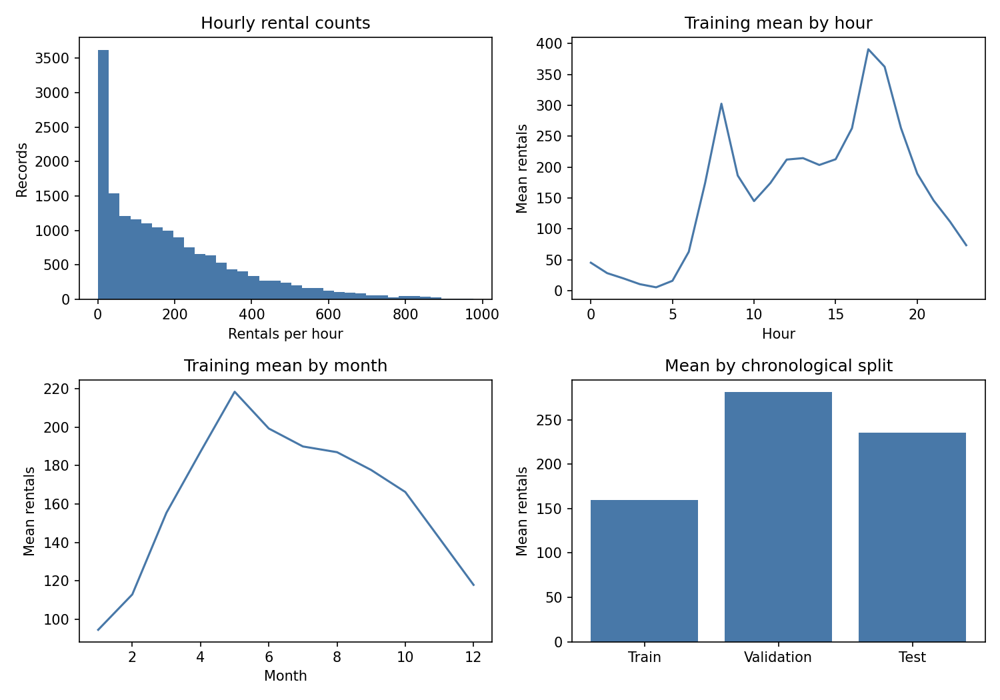

# Exploratory data analysis — hourly bike rentals

Source: `data/hour.csv`. Run `python eda.py` from the repository root to regenerate this summary and `outputs/figures/eda_overview.png`.

## Data quality and target

- 17,379 records from 2011-01-01 00:00 to 2012-12-31 23:00; 0 missing cells and 0 duplicate timestamps.
- 75 gaps between adjacent records, covering 165 absent hourly timestamps. The model excludes windows spanning a gap.
- `cnt = casual + registered` for all 17,379 rows. Counts range from 1 to 977; median 142, 95th percentile 563.1, mean 189.5.

## Patterns relevant to forecasting

- In training rows, mean demand peaks at 17:00 (390.9) and is lowest at 04:00 (5.2). This supports using hourly calendar features and a 24-hour history.
- Training monthly means range from 94.4 to 218.5. Training temperature and humidity have Pearson correlations of 0.399 and -0.301 with `cnt`; these are associations, not causal effects.
- Chronological splits have different target levels:

| Split | Rows | Mean `cnt` | Median `cnt` |
|---|---:|---:|---:|
| Train | 12,165 | 159.9 | 119.0 |
| Validation | 2,607 | 281.0 | 251.0 |
| Test | 2,607 | 235.7 | 186.0 |

The shift means test accuracy should be interpreted for this later period, not assumed to transfer unchanged to another year.

## Preprocessing decisions

| EDA observation | Decision in the pipeline |
|---|---|
| Absent hourly timestamps | Keep original timestamps and discard 24-to-5 windows crossing a gap; do not interpolate missing hours. |
| Strong hourly pattern in training data | Use the previous 24 hours and cyclic hour features. |
| Seasonal and weather associations in training data | Retain historical calendar and weather fields; cyclically encode month and weekday. |
| Different target means across chronological periods | Split by time, fit scalers on train only, and report test performance separately. |
| `cnt = casual + registered` in every record | Drop `casual` and `registered` when forecasting `cnt`. |

## Simple test baselines

Both baselines use the same 2,469 complete test forecast origins and five forecast hours as the model. Persistence repeats the last observed count; seasonal persistence uses the count 24 hours before each forecast hour.

| Method | MAE | RMSE | Pooled R² |
|---|---:|---:|---:|
| Last observation | 166.89 | 234.95 | -0.1850 |
| Same hour previous day | 79.99 | 132.60 | 0.6226 |

The saved model results in `outputs/metrics/test_metrics.json` report MAE 42.73, RMSE 65.87, and pooled R² 0.9069. These baselines provide context; they do not isolate the effect of attention.

