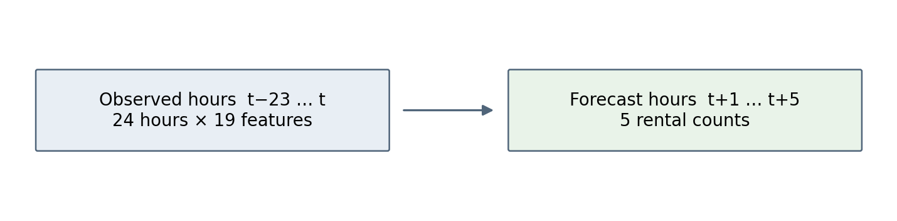
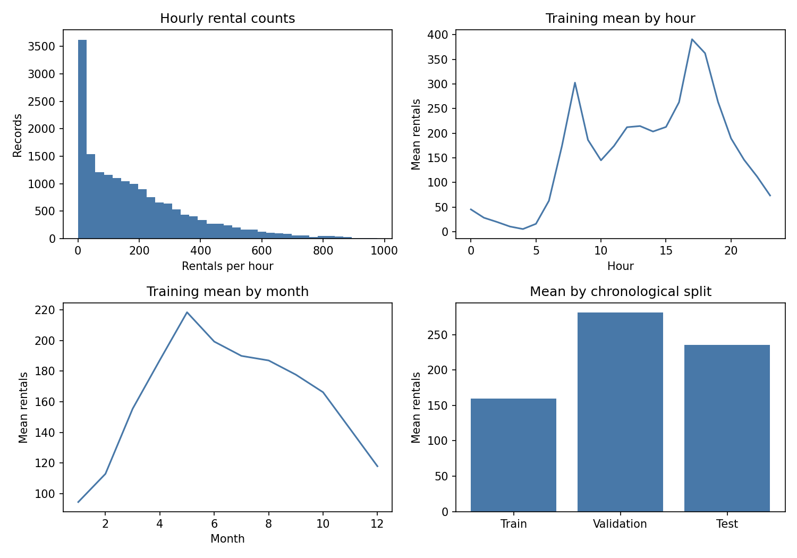
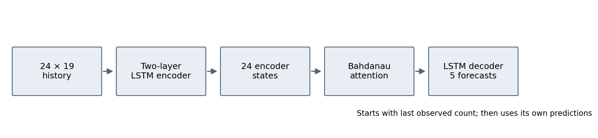
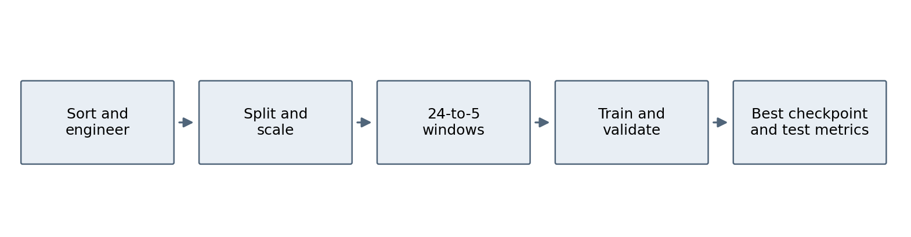
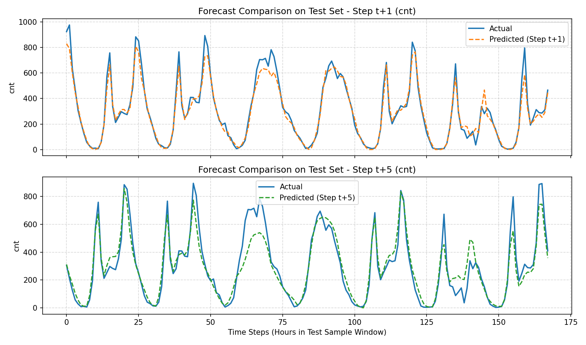

# 2. Task 2 – Forecasting Multiple Consecutive Future Time Points

## 2.1. Problem Description

### 2.1.1. Research Objective

The objective is to forecast total bike rentals for five consecutive future hours. We use an LSTM encoder–decoder with Bahdanau attention to learn from recent demand, calendar information, and observed weather. This is a multi-step forecasting task: the model returns five predictions from one 24-hour history.

### 2.1.2. Input and Output

Let $t$ be the last observed hour. The input $X_t$ contains 24 hourly vectors, from $t-23$ through $t$, with 19 features per hour. The target is $(cnt_{t+1},\ldots,cnt_{t+5})$. The last observed count $cnt_t$ initializes the decoder. At inference, no count from $t+1$ onward is supplied to it.

*Figure 2.1. Input history and five-hour forecasting horizon.*

## 2.2. Dataset and Data Preprocessing

### 2.2.1. Dataset Description

The [UCI Bike Sharing dataset](https://archive.ics.uci.edu/dataset/275/bike+sharing+dataset) contains 17,379 hourly records from 2011–2012. The target `cnt` is the total number of rentals and equals `casual + registered`. Inputs include historical counts, calendar fields, and historical weather observations. Future weather is not used.

### 2.2.2. Exploratory Data Analysis

The CSV has no blank cells or duplicate timestamps. It has 75 gaps between adjacent records, covering 165 unrecorded hours. In the training period, mean demand peaks at 17:00 (390.9 rentals) and is lowest at 04:00 (5.2), motivating an hour-of-day feature. This pattern alone does not establish that 24 hours is the best input length. Mean counts differ across the chronological train, validation, and test periods: 159.9, 281.0, and 235.7, respectively. The [EDA notebook](../notebooks/EDA.ipynb) quantifies gaps, window loss, lag dependence and candidate preprocessing choices.

*Figure 2.2. Data distribution and demand patterns. The hourly and monthly curves use training data; the split means describe all three periods.*

### 2.2.3. Feature Engineering

Hour, month, and weekday receive sine/cosine encodings so their cycles have no artificial break at the boundary. The model retains historical `cnt` but drops historical `casual` and `registered` for a simpler baseline because they sum to `cnt`. Past component counts are causal and could be useful; their value needs a validation ablation. It also drops the row identifier and date string after constructing timestamps. The resulting input has 19 features.

### 2.2.4. Data Splitting and Normalization

Rows are sorted by date and hour, then split in time order: 70% train, 15% validation, and 15% test. The feature and target `StandardScaler` objects are fitted only on training rows and applied to later periods. Validation and test can use the preceding 24 rows as known historical context; their forecast targets remain inside their own period.

### 2.2.5. Sliding Window Construction

Each sample pairs 24 observed hours with the following five hours. Windows crossing any unrecorded hour are discarded; no hourly rows are interpolated. The supplied CSV has no missing cells, so no cell imputation is part of this pipeline.

| Split | Valid forecast origins |
|---|---:|
| Training | 10,404 |
| Validation | 2,603 |
| Test | 2,469 |
| **Total** | **15,476** |

## 2.3. Model Architecture and Design

### 2.3.1. Overall Model Architecture

The encoder converts the 24 historical feature vectors into a sequence of hidden states. At each forecast step, attention summarizes those states for the decoder. The decoder then predicts one count and proceeds to the next step.

*Figure 2.3. Simplified encoder, attention, and decoder architecture.*

### 2.3.2. LSTM Encoder

The two-layer encoder has 64 hidden units per layer. For a batch of $B$ samples, its input shape is $(B,24,19)$ and its sequence of outputs has shape $(B,24,64)$. The final hidden and cell states initialize the decoder.

### 2.3.3. Bahdanau Attention Mechanism

At decoder step $k$, the previous top-layer decoder state $s_{k-1}$ scores each encoder state $h_i$. The implementation uses linear layers **without biases**:

$$e_{k,i}=v_a^\top\tanh(W_s s_{k-1}+W_h h_i),\qquad
\alpha_{k,i}=\frac{\exp(e_{k,i})}{\sum_{j=1}^{24}\exp(e_{k,j})},\qquad
c_k=\sum_{i=1}^{24}\alpha_{k,i}h_i.$$

The weights $\alpha_{k,i}$ sum to one across the 24 historical hours. The context vector $c_k$ is the weighted summary passed to the decoder. These weights describe model behavior; they do not establish a causal effect of attention on accuracy.

### 2.3.4. LSTM Decoder

The decoder receives the previous target value or prediction together with the attention context. A readout layer combines the decoder output, context, and previous value to predict the next count. It starts with the observed $cnt_t$ and produces five values sequentially. During validation and testing, later steps receive the decoder's own predictions.

## 2.4. Training Strategy and Experimental Setup

### 2.4.1. Training Configuration

| Setting | Value |
|---|---:|
| Encoder / decoder LSTM layers | 2 / 2 |
| Hidden units per layer | 64 |
| Trainable parameters | 138,497 |
| Loss / optimizer | Five-step MSE / AdamW |
| Initial learning rate / weight decay | 0.001 / 0.00001 |
| Batch size / dropout | 128 / 0.2 |
| Gradient norm clipping | 1.0 |
| Initial teacher forcing ratio | 0.5 |
| Maximum epochs / early-stop patience | 35 / 8 |
| Random seed | 42 |

### 2.4.2. Teacher Forcing Strategy

During training, the decoder sometimes receives the true count from the preceding forecast step instead of its own prediction. This happens with an initial probability of 0.5, which decreases across epochs. Validation and test inference use no teacher forcing, so the model must continue from its own predictions.

### 2.4.3. Model Optimization and Checkpoint Selection

AdamW minimizes the mean squared error over all five forecast steps. `ReduceLROnPlateau` halves the learning rate when validation loss stalls; training stops after eight epochs without improvement. The best checkpoint is selected using fully autoregressive validation MSE, then restored for test evaluation. In the verified run, it came from epoch 5 (validation MSE 0.1756); training stopped at epoch 13.

### 2.4.4. Training and Inference Workflow

*Figure 2.4. Experimental workflow.*

## 2.5. Evaluation Methodology

### 2.5.1. Evaluation Metrics

Predictions are inverse-scaled to rentals per hour and clipped at zero before scoring. For an observed vector $y_1,\ldots,y_n$ and predictions $\hat y_1,\ldots,\hat y_n$:

$$\mathrm{MAE}=\frac{1}{n}\sum_i|y_i-\hat y_i|,\qquad
\mathrm{RMSE}=\sqrt{\frac{1}{n}\sum_i(y_i-\hat y_i)^2}.$$

$$R^2=\mathrm{NSE}=1-\frac{\sum_i(y_i-\hat y_i)^2}{\sum_i(y_i-\bar y)^2}.$$

Standard $R^2$ and NSE have the same formula here, so they have the same value on every reported vector. The separate `R2_Pearson` field in the machine-readable output is squared Pearson correlation, which measures a different property.

### 2.5.2. Multi-horizon Evaluation

Each horizon is scored across 2,469 test forecast origins. The macro result averages the five horizon scores; the pooled result scores all $2,469\times5=12,345$ predicted values together. Because forecast windows overlap, those values are not independent observations for statistical inference.

### 2.5.3. Baseline Methods

Two simple forecasts use exactly the same complete test windows as the model. **Persistence** repeats the last observed count for all five hours. **Daily seasonal naive** uses the count exactly 24 hours before each forecast hour. Neither baseline uses future information.

## 2.6. Experimental Results and Discussion

### 2.6.1. Forecasting Performance by Horizon

| Horizon | R² | NSE | MAE | RMSE |
|---|---:|---:|---:|---:|
| t+1 | 0.9408 | 0.9408 | 34.1007 | 52.6394 |
| t+2 | 0.9152 | 0.9152 | 40.7705 | 62.8955 |
| t+3 | 0.9052 | 0.9052 | 43.3751 | 66.3678 |
| t+4 | 0.8947 | 0.8947 | 45.9726 | 69.9566 |
| t+5 | 0.8781 | 0.8781 | 49.4454 | 75.2998 |
| **Macro average** | **0.9068** | **0.9068** | **42.7329** | **65.4318** |
| **Overall pooled** | **0.9069** | **0.9069** | **42.7329** | **65.8717** |

### 2.6.2. Performance Across Forecast Horizons

MAE rises from 34.10 at $t+1$ to 49.45 at $t+5$, while $R^2$ falls from 0.9408 to 0.8781. This is consistent with growing uncertainty and possible error accumulation during autoregressive decoding. It does not by itself separate those two causes.

### 2.6.3. Comparison with Baseline Methods

| Method | Overall MAE | Overall RMSE |
|---|---:|---:|
| Persistence | 166.89 | 234.95 |
| Daily seasonal naive | 79.99 | 132.60 |
| **LSTM encoder–decoder with attention** | **42.73** | **65.87** |

The trained model has lower error than either simple baseline on this test period. This comparison evaluates the complete model, not attention by itself.

### 2.6.4. Forecast Visualization

The forecast plot shows actual and predicted counts for the first and fifth forecast horizons over the first 168 valid test origins. Its horizontal axis indexes forecast origins, which need not be consecutive clock hours because gap-crossing windows were removed.

*Figure 2.5. Test forecasts at horizons $t+1$ and $t+5$.*

### 2.6.5. Limitations and Discussion

The experiment uses one dataset, one chronological test period, and one principal architecture. The train, validation, and test periods have different average demand, so the reported accuracy may not transfer unchanged to another year or city. There is no no-attention ablation, so the results cannot isolate the contribution of attention. The reported point metrics remain valid for this test period, but overlapping windows require care with confidence intervals or significance claims.

## 2.7. Conclusion

The model produces five consecutive hourly forecasts from a 24-hour history. On 2,469 complete test forecast origins, it achieves pooled MAE 42.73, RMSE 65.87, and $R^2$ 0.9069, outperforming two simple baselines. Further work should repeat training with several seeds and compare a model without attention before attributing gains to that component.

## References

1. Fanaee-T, H., and Gama, J. (2014). Event labeling combining ensemble detectors and background knowledge. *Progress in Artificial Intelligence*, 2, 113–127. [Dataset record](https://archive.ics.uci.edu/dataset/275/bike+sharing+dataset).
2. Bahdanau, D., Cho, K., and Bengio, Y. (2015). Neural machine translation by jointly learning to align and translate. [arXiv:1409.0473](https://arxiv.org/abs/1409.0473).
3. Nash, J. E., and Sutcliffe, J. V. (1970). River flow forecasting through conceptual models part I: A discussion of principles. *Journal of Hydrology*, 10(3), 282–290. [DOI](https://doi.org/10.1016/0022-1694(70)90255-6).
4. scikit-learn developers. [R² score](https://scikit-learn.org/stable/modules/generated/sklearn.metrics.r2_score.html), [mean absolute error](https://scikit-learn.org/stable/modules/generated/sklearn.metrics.mean_absolute_error.html), and [root mean squared error](https://scikit-learn.org/stable/modules/generated/sklearn.metrics.root_mean_squared_error.html) documentation.
